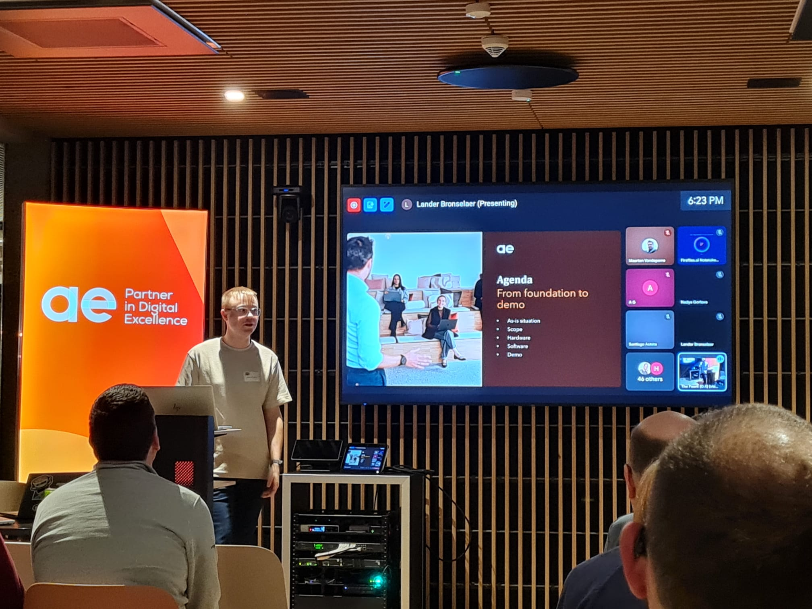
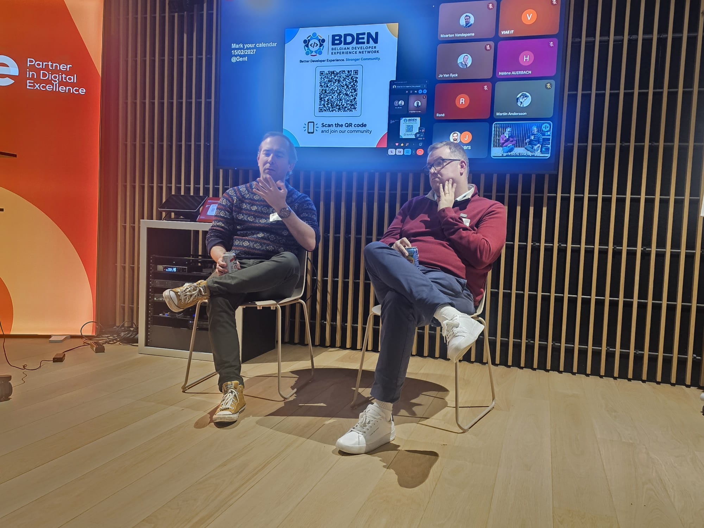
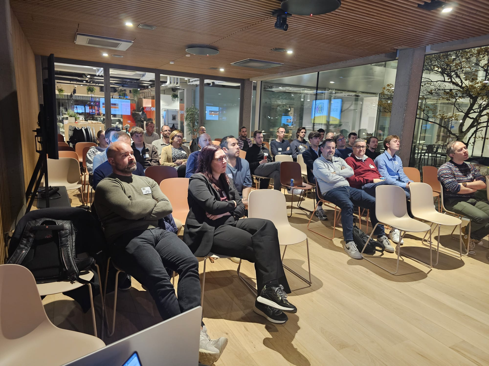
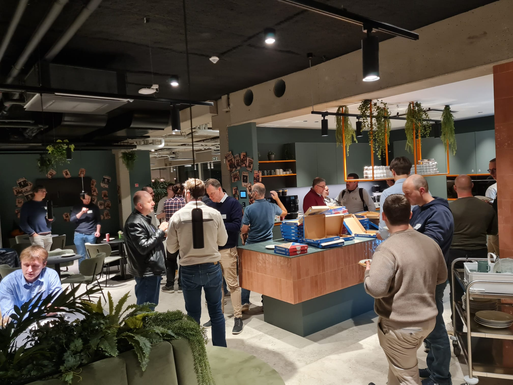

### **BDEN Meetup #7 – On-Prem AI & The Reality of (Vibe-)Coding**

On **October 27th**, the **Belgian Developer Experience Network (BDEN)** community came together for our **seventh meetup**, hosted at **AE in Heverlee (Leuven)**.

And what a turnout it was! We had a **full room in Leuven**, and **many more people joining online**. Thank you all for being there, whether in the room or behind your screen!

The evening was all about the questions developers are facing right now: **how do you run AI on your own infrastructure**, and **what does day-to-day development look like when AI is part of your workflow?**

---

### **The Sessions**

#### 🖥️ **On-Premises AI: The Full Stack, from Hardware to Software**
**Speaker: [Lander Bronselaer](https://www.linkedin.com/in/landerbronselaer/)** *(AE)*

Lander kicked off the evening with a deep dive into what it really takes to **run AI workloads on your own infrastructure**.

Rather than staying at the level of APIs and cloud endpoints, the session went all the way down the stack: **compute and GPU requirements**, **infrastructure architecture**, **AI platforms**, **deployment**, and the **software stack** that ties it all together.

Drawing on real-world experience, Lander showed both the **opportunities and the challenges** of bringing AI closer to your own data and infrastructure, and which key considerations matter when you decide to go on-prem instead of (or next to) the cloud.

---

#### 🤖 **(AI) Panel Discussion: Which Struggles Do We Face When (Vibe-)Coding?**
**Panel: [Jo Van Eyck](https://www.linkedin.com/in/jovaneyck/)** *(AE)* **& [Christophe Augello](https://www.linkedin.com/in/caugello/)** *(Red Hat)*

After the break, it was time for something different: an **interactive panel discussion**.

Jo and Christophe each started with a short showcase of **how they use AI in their own work**. Those demos quickly turned into what we hoped for: an **audience-wide conversation**, with questions and experiences coming from both the room and the online chat.

Topics ranged from **how to develop with AI** and where AI-assisted coding really helps, to where it still struggles, and how to keep your (developer) life easier rather than more complicated. It was great to hear so many different perspectives, from enthusiastic early adopters to healthy sceptics.

---

### **Food, Networking & Conversations**

As always, the evening ended with **food, drinks, and plenty of conversations** 🍕🍻.

The discussions from the panel continued well into the networking part, with people comparing tools, workflows, and on-prem setups. It was great to see so many **new faces** alongside our familiar community members.

---

### **Looking Ahead**

A big **thank you** to **Lander**, **Jo**, and **Christophe** for sharing their knowledge and experiences, to **AE** for hosting us, and to everyone who joined, on-site and online. 🙌

And we already have a date for the next one: our **next in-person meetup** takes place on **February 17th in Ghent**, hosted by **Inetum**. Save the date! More details will follow soon, so make sure to follow our [Meetup page]({{ page.meetup_link }}) to stay up to date.

Missed a session? Past recordings are available on [our YouTube channel](https://www.youtube.com/channel/UC4yPy9btGK99XAils6T2JBg).

See you in Ghent! 🚀

**#BDEN #AI #OnPremAI #VibeCoding #DeveloperExperience #Community**
